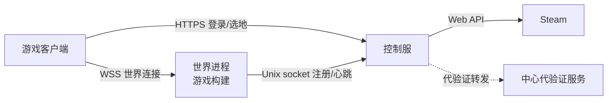

<p align="center">
  
</p>

<p align="center">
  <a href=".github/workflows/build.yml"></a>
  
  
  
</p>

# Wheatstead Server

自托管的 Steam 多人服务器：玩家用 Steam 账号登录，在自己的世界里选地、建房、串门。

> 游戏本体不开源，**这个仓库只包含服务器**。世界进程是游戏构建（`WheatsteadWorld --headless -- --server`），需要你自己的游戏客户端。

## 能做什么

| 能力 | 说明 |
|---|---|
| Steam 身份验证 | 客户端取 Steam 票据，服务器校验票据和所有权；正式版、Demo、Playtest 都能进，AppID 可配 |
| 代验证模式 | 没有发行商 Web API Key 也能开带验证的服，票据转发给中心服务验证，Key 不落到你的机器 |
| 官方世界 | 选地入场、地块归属、房屋与建造数据同步、房屋室内场景进出 |
| 世界重置 | 后台按周期重置世界，地块、建筑、物品和角色清空 |
| 排行榜 | 通关成绩提交与展示 |
| 管理后台 | 世界状态、在线玩家、地块归属、手动重置 |
| 反馈邮件 | 玩家提交问题报告，可选 SMTP 转发 |

## 架构



控制服负责身份、地块、世界状态；世界进程只跑游戏，两者用 Unix socket 通信，同机部署最简单。

## 快速开始

```bash
# 1. 编译
dotnet publish src/Wheatstead.PlaytestServer.csproj -c Release -r linux-x64 --self-contained true -o out

# 2. 配置
cp .env.example .env
$EDITOR .env

# 3. 启动
set -a; . ./.env; set +a
./out/Wheatstead.PlaytestServer
```

健康检查：`curl http://127.0.0.1:8081/v1/health`。

完整步骤（Steamworks 配置、世界进程环境变量、客户端接入、反向代理、报错对照）见 **[docs/TUTORIAL.md](docs/TUTORIAL.md)**。

## 两种验证方式

| 方式 | 需要准备 | 适合 |
|---|---|---|
| 自有 Web API Key | Steamworks 发行商账号 + `WHEATSTEAD_STEAM_WEB_API_KEY` | 游戏发行商 |
| 官方代验证 | `WHEATSTEAD_LICENSE_RELAY_URL` + `WHEATSTEAD_LICENSE_RELAY_TOKEN` | 没有 Steamworks 后台的自建服 |

官方代验证服务由项目作者提供，地址和令牌通过 QQ **3141995251** 申请（不写进仓库）。也可以自己部署一个代验证服务，做法见教程的「6.5 没有 Web API Key？用代验证模式」。

## 配置

| 变量 | 必填 | 说明 |
|---|---|---|
| `WHEATSTEAD_STEAM_APP_IDS` | 是 | 接受的 AppID，逗号分隔，例如 `5485050,5489270` |
| `WHEATSTEAD_STEAM_WEB_API_KEY` | 是* | Steamworks 发行商 Web API Key；用代验证时不需要 |
| `WHEATSTEAD_LICENSE_RELAY_URL` | 否 | 代验证服务地址 |
| `WHEATSTEAD_LICENSE_RELAY_TOKEN` | 否 | 代验证令牌，至少 32 字节 |
| `WHEATSTEAD_MULTIPLAYER_TOKEN_SECRET` | 是 | 入场令牌 HMAC 密钥，至少 32 字节，世界进程用同一个 |
| `WHEATSTEAD_MULTIPLAYER_DB` | 是 | 多人数据库路径（SQLite） |
| `WHEATSTEAD_LEADERBOARD_DB` | 是 | 排行榜数据库路径（SQLite） |
| `WHEATSTEAD_LEADERBOARD_URLS` | 否 | 监听地址，默认 `http://127.0.0.1:8081` |
| `WHEATSTEAD_WORLD_NAME` | 否 | 首次建库的世界名 |
| `WHEATSTEAD_STEAM_API_URL` | 否 | 默认 `https://partner.steam-api.com`，只接受 HTTPS |
| `WHEATSTEAD_STEAM_ALLOW_FAMILY_SHARING` | 否 | `1` 允许家庭共享，默认 `0` |
| `WHEATSTEAD_LEADERBOARD_ADMIN_PASSWORD` | 否 | 管理后台密码 |
| `WHEATSTEAD_RESET_WORKER_ENABLED` | 否 | `1` 开启世界重置任务 |

完整列表和示例见 [`.env.example`](.env.example)。

## 接口

| 方法 | 路径 | 说明 |
|---|---|---|
| GET | `/v1/health` | 健康检查 |
| POST | `/v1/multiplayer/steam-login` | Steam 票据换入场令牌 |
| GET | `/v1/multiplayer/worlds` | 世界列表 |
| GET | `/v1/multiplayer/worlds/{id}/map` | 地图、地块、入场就绪状态 |
| POST | `/v1/multiplayer/worlds/{id}/select` | 选地入场 |
| POST | `/v1/license/verify` | 代验证（需要 `WHEATSTEAD_LICENSE_RELAY_TOKEN`） |
| GET/POST | `/v1/speedruns` | 排行榜 |
| POST | `/v1/feedback` | 问题反馈（可选） |
| GET | `/admin` | 管理后台 |

## 部署

`deploy/` 里有 systemd 单元示例。要点：

- 独立低权限用户运行，env 文件放 `/etc/wheatstead/server.env`，权限 600；
- Caddy/Nginx 终止 TLS，只把 `/v1`、`/admin` 反代到 `127.0.0.1:8081`，世界端口单独反代或直接放行；
- SQLite 文件定期备份，不要把数据库和 `.env` 提交进仓库。

## 测试

回归脚本在游戏主仓库里，不随本仓库发布。改完代码至少跑：

```bash
dotnet build src/Wheatstead.PlaytestServer.csproj
```

然后按教程启动一次，确认 `/v1/health` 里的 `steam_login_enabled` 和 `license_relay_enabled` 符合预期。

## 常见问题

**没有 Steamworks 账号能开吗？**
能跑控制服，但没有 Steam 验证；带验证的服需要发行商 Key 或官方代验证令牌。

**Demo 和正式版能进同一个服吗？**
能，把两个 AppID 都写进 `WHEATSTEAD_STEAM_APP_IDS`。

**重启控制服后玩家进不去？**
世界心跳会断，重启世界进程恢复 `entry_ready`。

**支持 Windows/macOS 吗？**
只在 Linux x64 验证过；其他平台理论上能编译，但没有测试。

## 联系

QQ：3141995251

## 许可证

MIT，见 [LICENSE](LICENSE)。
